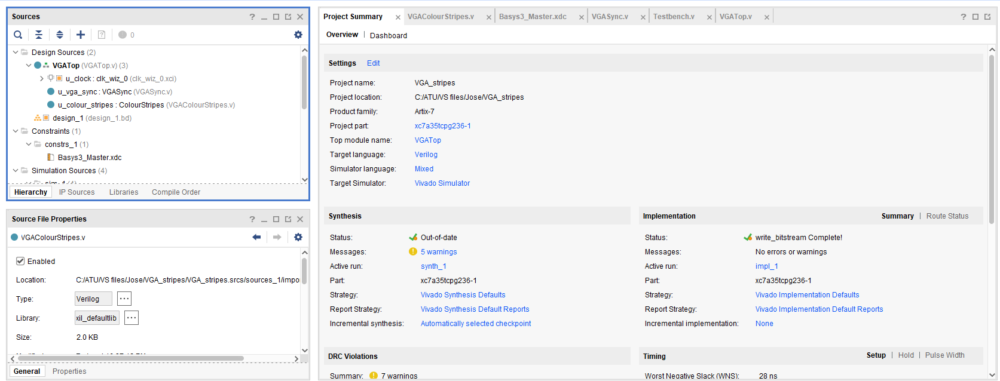
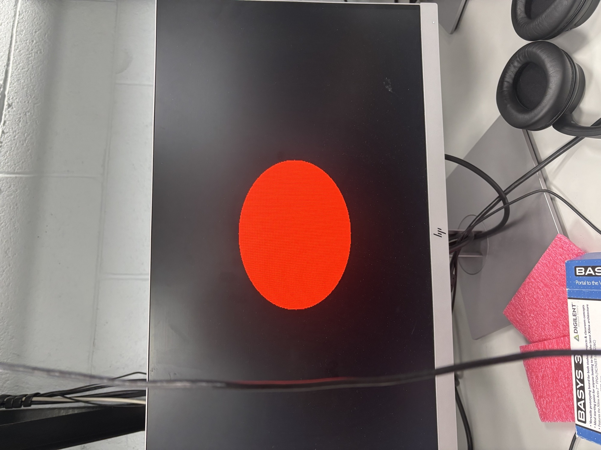

 
Hi welcome to my FGPA VGA Driver Project where I am going to show how I created different pictures by pushing a button.

## **Template VGA Design**
### **Project Set-Up**
I used the Xilinx Artix-7 board. I used Vivado to development environment to configure the Xilinx Artix-7 board. The language I used to program the board was Verilog.
I was given the VGAColourStripes.v file which contains the logic responsible for generating the colours/patterns displayed on the screen. I was given the VGASync.v fiel which generates the VGA synchronization signals (horizontal and vertical sync) and pixel coordinates. Finally, I was given the Bassys3_Master.xdc file which defines the physical pin assignments and hardware constrains for the Bassys 3 board.
## 
### **Template Code**
Outline the structure and design of the Verilog code templates you were given. What do they do? Include reference to how a VGA interface works. Guideline: 2/3 short paragraphs, consider including screenshot(s).
The structure that I was given was a testbench, VGASync, ColourStripe and Basys2_Master.xdc.

A testbench is a simulation environment used to verify the functionality and correctness of a design written in Verilog. It applies inputs to the design, observes its outputs, and checks whether the outputs are what the specification says they should be. Testbenches let engineers simulate a design under many different conditions before it is turned into hardware. Bugs found in simulation cost minutes to fix; the same bugs found in a manufactured chip can cost months and the price of a new set of masks. 

The VGASync module is responsible for generating the VGA synchronization signals and tracking the current pixel position on the display. It uses two 11-bit counters, hcount and vcount, to track the horizontal and vertical pixel positions. Once it reaches its maximum value (799), it resets to zero and increments the vertical counter. The synchronization signals are uses to tell the monitor when to return to a new line. It also generates a vid_on signal, which identifies whether the current pixel is within the visible 640 × 480 display area. Finally, the row and col outputs provide the current pixel coordinates to other modules, allowing them to determine which colour should be displayed at each position.

The Bassys_master.xdc file dines the physical pin assignments and hardware constrains for the Bassys 3 board.
### **Simulation**
Explain the simulation process. Reference any important details, include a well-selected screenshot of the simulation. Guideline: 1/2 short paragraphs.
### **Synthesis**
Describe the synthesis and implementation processes. Consider including 1/2 useful screenshot(s). Guideline: 1/2 short paragraphs.
### **Demonstration**
Perhaps add a picture of your demo. Guideline: 1/2 sentences.

## **My VGA Design Edit**
Introduce your own design idea. Consider how complex/achievabble this might be or otherwise. Reference any research you do online (use hyperlinks).

My project idea was to push a button and to display different images on my monitor. First I went to try different stripe colours to understand how does the code work. Once I got a sense of it I decided to make a circle. But in order to make a circle I needed to use the mathematical formula to create a circle. I used AI and my lectures notes to understand how does that work. Later I decided to use the button to swap between two pictures. The  pictures I wanted to swap around were a circle and a cross.
### **Code Adaptation**
Briefly show how you changed the template code to display a different image. Demonstrate your understanding. Guideline: 1-2 short paragraphs.
A circle was made by using AI and my lectures notes to understand how does that work. Later I decided to use the button to swap between two pictures.

The set_property PACKAGE_PIN U18 [get_ports button] and set_property IOSTANDARD LVCMOS33 [get_ports button] lines from the Basus3_Master.xdc file  were uncomment to enable the button and to assign it to the testbench and ColourStripe module to make use of it.

### **Simulation**
Show how you simulated your own design. Are there any things to note? Demonstrate your understanding. Add a screenshot. Guideline: 1-2 short paragraphs.

### **Synthesis**
Describe the synthesis & implementation outputs for your design, are there any differences to that of the original design? Guideline 1-2 short paragraphs.

### **Demonstration**
If you get your own design working on the Basys3 board, take a picture! Guideline: 1-2 sentences.
The design worked successfully. If the middle button is pressed the picture will change. Due to lack of preparation the cross was not successfully implemented as it required to calculate the points of the line, the slope and the equation of the line to be implemented. However I used the same circle with a different colour to test the code.

## **More Markdown Basics**
This is a paragraph. Add an empty line to start a new paragraph.

Font can be emphasised as *Italic* or **Bold**.

Code can be highlighted by using `backticks`.

Hyperlinks look like this: [GitHub Help](https://help.github.com/).
https://chipverify.com/verilog/verilog-testbench

A bullet list can be rendered as follows:
- vectors
- algorithms
- iterators

Images can be added by uploading them to the repository in a /docs/assets/images folder, and then rendering using HTML via githubusercontent.com as shown in the example below.

